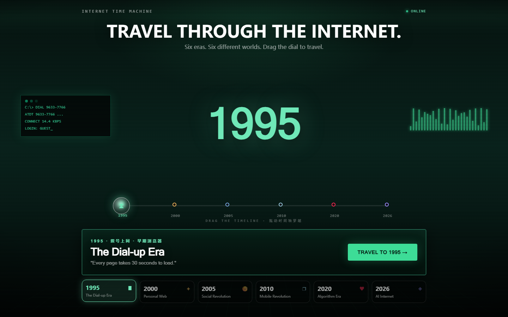
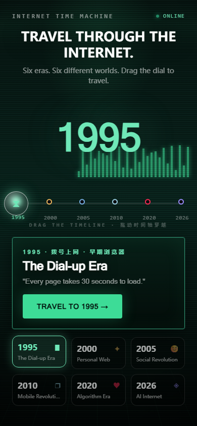

# Internet Time Machine

**中文** | [English](#english)

## 项目简介

一台跑在浏览器里的互联网时光机。拖动时间轴穿越 1995 → 2000 → 2005 → 2010 → 2020 → 2026 六个年代，每个年代都是一套完整的、可交互的复古界面：Win95 桌面与拨号上网、千禧年个人主页、论坛与个人空间、iPhone 4 与 iOS 4、短视频算法信息流、AI Agent 工作空间。

年代之间不是简单跳转，而是一段五阶段的「时空隧道」转场：旧世界坍缩、粒子隧道加速、新世界显影落地，全程无白屏。

## 在线体验

https://yucai0302.github.io/internet-time-machine/

## 预览





## 功能

- **时光机控制室**：可拖拽时间轴（0..5 连续进度），拖动过程中整站背景、字体、强调色与音效实时切换，松手弹簧吸附到最近年代。
- **五阶段时空隧道转场**：坍缩 → 加速 → 隧道飞行 → 显影 → 淡出，转场层独立渲染，旧舞台保持挂载，避免闪屏。
- **六套独立年代模块**，各自封装、互不影响：
  - **1995 · The Dial-up Era**：Win95 启动画面、CRT 扫描线、桌面图标、开始菜单与任务栏、可交互的拨号上网窗口（含调制解调器握手音）与 WebSurfer 1.0 浏览器、记事本。
  - **2000 · Personal Web**：个人主页搭建器、带 GIF 装饰的页面预览，还原千禧年网页审美。
  - **2005 · Social Revolution**：论坛首页/版块/发帖/帖子详情、个人空间、好友与私信，一整套早期社交网络。
  - **2010 · Mobile Revolution**：iPhone 4 拟物化外框与实体按键、滑动解锁、iOS 4 主屏幕、16 个可交互 App（Safari、音乐、相册、地图、短信、设置、社交等）、Home 键与多任务、通知与锁屏。
  - **2020 · Algorithm Era**：短视频信息流、点赞/评论/分享、基于行为追踪与兴趣画像的本地推荐算法、推荐理由与信息流偏移可视化。
  - **2026 · AI Internet**：多 Agent 协作工作空间，规划/研究/分析/写作/执行 Agent 由统一执行引擎调度，支持暂停、继续、取消与任务历史（本地模拟，无真实联网或大模型调用）。
- **全局音效系统**：基于 Web Audio 合成，不同年代对应不同提示音色（beep / MIDI / IM / SMS / 通知 / AI），无需任何音频素材。
- **响应式与降级**：适配桌面与移动视口，支持系统「减少动态效果」偏好。

## 快速开始

```bash
npm install
npm run dev      # 开发服务器
npm run build    # 生产构建
npm run preview  # 预览构建产物
```

浏览器打开终端输出的地址（默认 http://localhost:5173）。

## 目录结构

```
src/
├── App.tsx                  # 顶层状态机：首页 / 时代页 / 预告页 + 穿越流程
├── home/                    # 时光机控制室：时间轴、时代卡片、背景场景
├── core/
│   ├── eras/                # 六个年代的主题元数据
│   ├── transition/          # 时空隧道转场（五阶段 + 粒子引擎）
│   ├── audio/               # Web Audio 合成音效
│   └── window/              # 通用窗口系统
└── eras/
    ├── era1995/             # Win95 桌面
    ├── era2000/             # 千禧年个人主页
    ├── era2005/             # 论坛与个人空间
    ├── era2010/             # iPhone 4 / iOS 4
    ├── era2020/             # 短视频算法信息流
    └── era2026/             # AI Agent 工作空间
```

## License

MIT

---

<a id="english"></a>

# Internet Time Machine

## Overview

A time machine for the internet, running entirely in the browser. Drag the timeline to travel through six eras — 1995, 2000, 2005, 2010, 2020 and 2026 — each rendered as a complete, interactive period interface: a Windows 95 desktop with dial-up networking, a millennium-era personal homepage builder, forums and social profiles, an iPhone 4 running iOS 4, an algorithm-driven short-video feed, and a multi-agent AI workspace.

Eras are connected by a five-stage time-tunnel transition: the old world collapses, particles accelerate through the tunnel, and the new world develops and settles — with no white flash in between.

## Live demo

https://yucai0302.github.io/internet-time-machine/

## Preview


## Features

- **Time machine control room**: a draggable timeline (continuous 0..5 progress). Background, typography, accent colors and sound switch live while dragging; releasing snaps to the nearest era with a spring animation.
- **Five-stage time-tunnel transition**: collapse → acceleration → tunnel flight → develop → fade out. The transition layer renders independently while the old stage stays mounted, avoiding flicker.
- **Six self-contained era modules**, isolated from each other:
  - **1995 · The Dial-up Era**: Windows 95 boot screen, CRT scanlines, desktop icons, Start menu and taskbar, an interactive dial-up networking window with modem handshake sounds, the WebSurfer 1.0 browser and Notepad.
  - **2000 · Personal Web**: a homepage builder with a live page preview full of GIF decorations, recreating millennium web aesthetics.
  - **2005 · Social Revolution**: forum index, boards, new-thread composer, thread view, profiles, friends and private messages — a full early social network.
  - **2010 · Mobile Revolution**: skeuomorphic iPhone 4 frame with physical buttons, slide-to-unlock, iOS 4 home screen, 16 interactive apps (Safari, Music, Photos, Maps, Messages, Settings, Social and more), Home button, multitasking, notifications and lock screen.
  - **2020 · Algorithm Era**: short-video feed with like/comment/share, a local recommendation algorithm driven by behavior tracking and interest profiles, plus recommendation reasons and feed-shift visualization.
  - **2026 · AI Internet**: a multi-agent workspace where planner, researcher, analyst, writer and executor agents are scheduled by a single execution engine, with pause, resume, cancel and task history (local simulation only — no real network or LLM calls).
- **Global sound system**: synthesized with Web Audio; each era has its own cue flavor (beep / MIDI / IM / SMS / notification / AI) and no audio assets are required.
- **Responsive with graceful degradation**: works on desktop and mobile viewports and respects the system "reduce motion" preference.

## Quick start

```bash
npm install
npm run dev      # dev server
npm run build    # production build
npm run preview  # preview the build
```

Open the URL printed by the dev server (http://localhost:5173 by default).

## Project structure

```
src/
├── App.tsx                  # top-level state machine: home / era / coming-soon + travel flow
├── home/                    # control room: timeline, era cards, background scenes
├── core/
│   ├── eras/                # theme metadata for the six eras
│   ├── transition/          # time-tunnel transition (five stages + particle engine)
│   ├── audio/               # Web Audio synthesized sounds
│   └── window/              # shared window system
└── eras/
    ├── era1995/             # Windows 95 desktop
    ├── era2000/             # millennium personal homepage
    ├── era2005/             # forums and social profiles
    ├── era2010/             # iPhone 4 / iOS 4
    ├── era2020/             # short-video algorithmic feed
    └── era2026/             # AI agent workspace
```

## License

MIT
